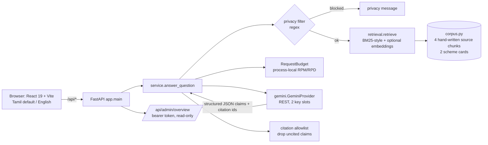

# Existing system analysis (Phase 0)

**Date:** 10 November 2026

## Architecture as built

## Component review

| Component | What it does well | Gaps | Verdict |
|---|---|---|---|
| `app/config.py` | Env-driven model names, budgets, CORS; secrets server-side only | Settings are read at import time (hard to test); default model is deprecated (TD-02) | **Reuse, modify** (move to pydantic-settings or keep the dataclass with a factory) |
| `app/gemini.py` | No SDK dependency; hides provider bodies and keys from errors; structured output schema; rotates keys only on 401/403, never to dodge 429 (complies with Google's per-project quota rule) | No `Retry-After` handling; health states don't match the required `HEALTHY / DEGRADED / RATE_LIMITED / UNAVAILABLE / CONFIGURATION_ERROR` set; blocking `urllib` inside sync endpoints; no token-usage accounting | **Reuse, extend** |
| `app/retrieval.py` | Tamil Unicode-aware tokeniser; optional dense retrieval falls back cleanly | No confidence threshold, and max-normalisation guarantees the top hit scores 0.55 (TD-03); no stop-words; per-request re-tokenisation of the whole corpus; embeddings cached in memory only | **Modify** (threshold, stop-words) then **replace** with Postgres FTS + pgvector when the DB lands |
| `app/service.py` | Abstains without evidence; returns search mode when Gemini fails; drops uncited claims | Privacy filter blocks ordinary self-description in both languages (TD-01); one global budget lets a single anonymous client exhaust the daily AI allowance (TD-05); citation check confirms the ID exists, not that the passage supports the claim | **Modify** |
| `app/corpus.py` | Every record says it is a directory summary; eligibility disabled; dates recorded | Hand-authored Python constants; 4 chunks; written before the 2026 scheme renamings were checked (TD-04) | **Replace** with DB-backed, versioned source records; keep the text as seed data |
| `app/security.py` | Constant-time token compare | Single static admin token; no RBAC | **Reuse** for local dev; replace with real auth for admin |
| `app/main.py` | Small, clear routes; CORS locked to localhost; `/api/docs` | No per-IP rate limit, request-size middleware, or security headers | **Modify** |
| `migrations/0001_initial_schema.sql` | Good provenance model: `source_versions`, `claim_evidence`, reviewer constraints on approval, and deliberately no citizen PII tables | Embeddings as JSONB (no pgvector); no FTS columns or indexes; no conversations, saved schemes, or notifications (intentionally omitted; revisit with a privacy design); no migration runner | **Reuse as the base**, add `0002` for pgvector + FTS |
| `frontend/src/App.tsx` (~28 kB, one file) | Bilingual, accessible markup, original styling, honest status labels | Single-file component; no router, tests, or lint; no i18n files (strings inline) | **Reuse visuals, refactor** into `features/` + `locales/` |
| `backend/tests` | Tests the safety properties (privacy, fallback, allowlist, quota) without live keys | No API-level tests (`TestClient`), no test that legitimate personal-context questions pass, no false-positive retrieval test | **Extend** |
| `backend/evaluation` | Honest about being synthetic | 8 cases over 4 docs; no negative-retrieval metric; no generation eval | **Extend** |
| Root docs | Thorough and conservative | `MARKET_RESEARCH.md` Phase 0 section is stale (says "not a git repository"); several Phase 0/1 deliverables required by the current brief were missing | **Updated in this phase** |

## Reuse / modify / replace / missing

- **Reuse:** Gemini adapter design, citation allowlist, abstention and fallback flow, schema provenance model, bilingual UI direction, safety-oriented docs.
- **Modify:** privacy filter, retrieval scoring, default model, request budgeting, health-state vocabulary.
- **Replace (later phases):** static Python corpus → PostgreSQL source registry + ingestion; in-memory retrieval → FTS + pgvector hybrid.
- **Missing:** licence, CI, frontend tests, API tests, ingestion pipeline, source monitoring, eligibility rule engine, checklists, comparison, auth/RBAC, deployment config, the `FREE_TIER_AUDIT.md` required by the brief (added in this phase).

## Security observations

- No secrets found in history or tracked files.
- Gemini keys never reach the client; provider error bodies are suppressed.
- `/api/ask` is unauthenticated and has only a global budget. That is fine on loopback, but **not safe to expose publicly** without per-client limits (TD-05).
- The prompt tells Gemini that evidence is untrusted. That is helpful, but it is the only prompt-injection control. Corpus text is authored by the team today; once real documents are ingested this becomes a real risk.
- The free-tier Gemini terms let Google use submitted content to improve its products. This is why the current filter is aggressive, and the TD-01 fix has to preserve that intent (see the proposal there).
