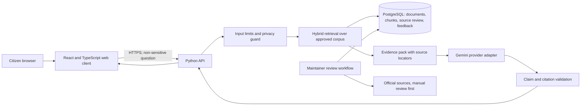

# CivicLens initial architecture blueprint

**Status:** Phase 3 proposal
**Date:** 9 November 2026
**Design goal:** Small, reviewable, low-cost application for a curated Tamil Nadu pilot

## Architecture overview

## Proposed stack

- **Web:** React + TypeScript + Vite; responsive, accessible components. No AI calls or secrets in browser code.
- **API:** Python + FastAPI with typed request/response schemas, request-size limits and explicit service boundaries.
- **Storage:** PostgreSQL for source registry, document metadata, chunks, review events, and anonymous feedback. Start with PostgreSQL full-text search plus metadata filters; add `pgvector` only if a small evaluation demonstrates value. Avoid a separate vector service at MVP.
- **Generation:** Gemini API behind a server-only provider interface. Model name and keys are environment configuration; model selection is verified at implementation time against current eligible models and quota. Two keys enable controlled failover only; quotas are project-scoped.
- **Ingestion:** Curated/manual import for first sources. Later fetcher, if approved by terms, runs as a separately rate-limited task and writes a new source version to review status, never directly to published.
- **Operations:** Structured error/latency/usage counters without raw citizen prompts, key material, or source secrets. Health checks reveal readiness and provider configuration state, not credentials.

No vendor is selected for public hosting at this stage. Current free-tier plan terms, geographic data handling, pause/backup behavior, commercial eligibility, and costs must be revalidated before any deployment. Vercel Hobby, for example, is restricted to personal/non-commercial use; it is not assumed to support a public CivicLens launch.

## Request flow

1. Browser submits a bounded general question and language preference; user is warned not to include sensitive personal data.
2. API validates schema, rate limit, length, jurisdiction, and likely sensitive input. Reject or redact high-risk material without sending it to Gemini; don't claim automated detection is perfect.
3. Retriever finds candidate source chunks using lexical and metadata search; semantic search is optional after evaluation.
4. Evidence pack includes only active, reviewed passages and carries source version, exact locator, source owner and verification date.
5. Gemini is asked for structured, language-matched claims strictly from evidence and an explicit insufficient-evidence result.
6. Server validates response schema and citation IDs against retrieved passages. Invalid or unsupported claims are discarded and trigger abstention/fallback.
7. Browser renders short explanation, citations, freshness, caveat, and official next step. Do not store chat by default.

## Core data model

| Entity | Key fields | Notes |
|---|---|---|
| `source` | id, owner, jurisdiction, canonical_url, source_type, language, terms_status, access_method, review_due | Authority and access record. |
| `source_version` | id, source_id, publication_date, effective dates, document_number, content_hash, fetched_at, verified_at, status, reviewer | Separate system fetch from human verification. Keep review history. |
| `document` | id, version_id, title, media_type, locator_scheme, canonical_url | Documents remain linked to the original source. Store only necessary excerpt/content and under allowed terms. |
| `chunk` | id, document_id, locator, text, language, tsvector, embedding (optional), active | Citation granularity; embeddings only for public approved content. |
| `scheme` | id, name_en, name_ta, owner, geography, category, official_route, status | Curated index, not authoritative rules by itself. |
| `scheme_evidence` | scheme_id, chunk_id, claim_type, reviewer_status | Explicit links from a field/claim to evidence. |
| `eligibility_rule` | id, scheme_id, question_code, operator, value, evidence_id, review_status | Deterministic rule representation; no model-generated rule execution. |
| `feedback` | id, source/scheme, category, created_at, rate-limit hash | No raw chat; free text omitted or tightly bounded and warned. |
| `review_event` | entity, actor, action, timestamp, rationale | Append-only change/audit trail. |

## Security and privacy boundaries

- Keep API keys in approved server environment; redact them from errors and health payloads.
- No citizen account/profile/document storage in the first release.
- Avoid request-body logging, analytics replay, and third-party tracking of question content.
- Minimize collected fields; use opaque IDs and least privilege for maintainer access.
- Treat retrieved text as untrusted; delimit data and ignore any instructions embedded in sources.
- Apply CORS allowlist, HTTPS at host, parameterized SQL, output encoding, request validation, rate limits, and dependency pinning.
- For database backups, define retention and test restore before storing user data; the first corpus can be reconstructed from reviewed source files and metadata.

## Failure handling

| Failure | Behavior |
|---|---|
| Gemini quota/429 or timeout | One bounded retry with backoff for transient errors; then return provider-unavailable message or search-only results. Do not automatically rotate keys to evade a quota. |
| Primary key invalid | Mark configured credential unhealthy and try secondary only for operational failover, within the same project quota and provider terms. Never return key state beyond healthy/unavailable. |
| No relevant evidence | Abstain and provide official search/contact routes if verified. |
| Sources conflict or are overdue | Hide affected claims and mark content for human review. |
| Database unavailable | Return a safe error; never answer from stale unversioned prompt cache. |
| Ingestion fails | Keep previous published version only if still within its verified freshness policy; otherwise expire time-sensitive claims. |

## Data lifecycle and recovery

Each release of source content is versioned with a hash and reviewer event. Retain the prior published record only as long as necessary for audit/recovery and applicable rights. Back up database schema and reviewed metadata; test restore in a non-production environment. Source PDFs may not be redistributed; preserve canonical links and minimal permitted excerpts. No actual database or cloud resource has been provisioned.

## Resource and cost limits

- Local work uses source code and small synthetic fixtures only; no local model training, weights, or large embeddings.
- Apply per-request and global daily Gemini limits in the application, independent of provider free quota.
- Keep corpus small enough for PostgreSQL FTS and optionally small vector indexing; cap uploads/ingestion file size.
- Fail closed when the configured request budget is exhausted. No automatic paid fallback, billing activation, or model-provider substitution.
- Before hosting, confirm current quota, plan terms, privacy, backup, availability, and measured monthly cost from a realistic pilot workload.

## Open decisions for implementation

1. Obtain the latest controlling government rules and approval to publish the first scheme records.
2. Decide whether evaluation justifies semantic embeddings; choose an eligible Gemini embedding model or no vector search at all.
3. Verify selected hosting/database legal terms and non-commercial/public-interest eligibility before deployment.
4. Define deletion/retention policy for anonymous feedback and operational logs.
5. Choose the initial user research and Tamil review participants; none have yet been recruited.
